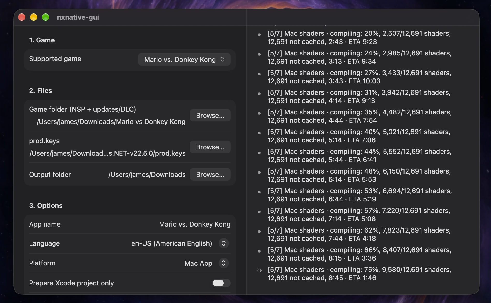

# nxnative-gui

A macOS app that puts a graphical interface on [nxnative](https://github.com/seedds/nxnative), a project that converts Nintendo Switch games (NSP, XCI, NSZ and XCZ files) into apps that run natively on Apple silicon: a Mac app, or an unsigned IPA for iPhone and iPad.

nxnative itself is a command-line tool (`scripts/build_ipa_from_nsp.py`). This app does not reimplement any of it. It downloads nxnative for you, makes sure its dependencies are installed, collects the options in a form, runs the script, and shows the progress as it goes.

**The app is published in the [Releases](../../releases) section of this repository.** Download it from there. You only need to build from source if you want to modify it.



## What the app does

- **Downloads and updates nxnative automatically.** Every time the app opens, it clones nxnative (first run) or updates it to the latest version, so you never handle the repository yourself.
- **Lists the supported games.** Only games that have a profile in nxnative can be converted. The list is read from nxnative's `dm/games/README.md` on every launch, so it stays current as games are added. You search it by typing.
- **Installs the requirements.** On launch it checks the tools nxnative needs and installs whatever is missing (see below).
- **Runs the conversion.** You pick a game, then the folder with its game files, your `prod.keys`, and an output folder. The app name defaults to the game's name, and you can edit it.
- **Shows progress as plain status lines** with icons for finished steps, failures and errors, rather than raw terminal output.

### Options

| Option | Description |
|---|---|
| Supported game | The game to convert. Searchable. |
| Game folder | A folder with the game's base file, plus updates and DLC if you have them. Accepted file types: `.nsp`, `.xci`, `.nsz` and `.xcz`. |
| prod.keys | Your Switch encryption keys file. |
| Output folder | Where the finished app is saved. If empty, nxnative saves it next to the game files. |
| App name | Defaults to the selected game's name. Editable. |
| Language | The game language, from the 16 languages nxnative supports (default `en-US`). |
| Platform | **IPA** (iPhone / iPad) or **Mac App**. |
| Prepare Xcode project only | Prepares an Xcode project instead of a finished package. |
| Show FPS overlay | Shows the frame rate in the converted game. |

## Requirements

### System

- A Mac with **Apple silicon**, running **macOS 27** or later (the deployment target of this app).
- **[Xcode](https://apps.apple.com/app/xcode/id497799835)** (free on the Mac App Store), installed and opened at least once. The Command Line Tools alone are not enough, because they don't include the Metal compiler. The app shows an error at startup if Xcode is missing. nxnative uses its compilers, `git` and the Python 3 that ships with it.
- **[Homebrew](https://brew.sh)**. The app uses it to install the tools below, and shows an error at startup if it's missing. The app cannot install Homebrew for you, because Homebrew's installer needs an administrator password.
- An internet connection, for downloading nxnative, its dependencies and the Metal Toolchain.
- **Plenty of disk space and time.** The first conversion of a game can take 30–60 minutes.

### Installed automatically on first launch

You do not need to install these yourself. The app detects what's missing and installs it.

| Requirement | Installed with |
|---|---|
| `dotnet` (.NET SDK) | Homebrew |
| `xcodegen`, `zstd`, `spirv-cross`, `glslang` | Homebrew |
| Python modules `lz4`, `capstone`, `fonttools`, `backports.zstd` | `pip` |
| Xcode's Metal Toolchain | `xcodebuild -downloadComponent MetalToolchain` |

The first launch can therefore take several minutes, and the Metal Toolchain is a large download.

### Your own game files

This project does not include, download or distribute any games or keys. You must provide:

- **The game's file(s)** (`.nsp`, `.xci`, `.nsz` or `.xcz`), dumped from a game you own.
- **`prod.keys`**, dumped from your own Switch console.

### Supported games

Only games with a profile in nxnative are supported (60+ at the time of writing). Games without one will fail during conversion. See nxnative's [supported games list](https://github.com/seedds/nxnative/blob/main/dm/games/README.md#games).

## Using the app

1. Open the app and wait for the startup check to finish ("Ready.").
2. Choose a **supported game**.
3. Choose the **game folder**, your **`prod.keys`**, and an **output folder**.
4. Adjust the options if you like, then press **Build**.

An IPA produced by nxnative is unsigned, so installing it on an iPhone or iPad requires sideloading. See the nxnative documentation for details.

Closing the window quits the app. **Cancel** stops a running build or install.

## Where files are stored

The nxnative copy the app downloads lives in:

```
~/Library/Application Support/<the app's bundle identifier>/nxnative
```

The app owns this folder and resets it to match the upstream repository on every launch, so don't make changes inside it. Conversion work files go next to your game files, in `<title ID>_build` folders.

## Building from source

1. Open `nxnative-gui.xcodeproj` in Xcode.
2. Select the `nxnative-gui` scheme and a Mac destination, then run.

The app has to run **without the App Sandbox**, because it launches `git`, `python3` and other command-line tools. This is already turned off in the project.

## Anti-piracy policy

This repository does not encourage or condone piracy. nxnative-gui is intended only for people who own the games they convert and have made legal backups of them, using their own console and their own keys.

Any mention of piracy in the Issues section (requests for game files or keys, links to them, or help with pirated copies) will be deleted.

## License

This project is free and open source, released under the [MIT License](LICENSE). You can use, modify and share it, including commercially, as long as the license notice is kept.

The MIT License covers only the code in this repository. [nxnative](https://github.com/seedds/nxnative) is a separate project with its own license. The app downloads it at run time and does not include any of its code.

## Disclaimer

This project is an independent graphical front end and is not affiliated with or endorsed by nxnative, Nintendo or Apple. All conversion work is done by nxnative. Use it only with games and keys that you legally own.
